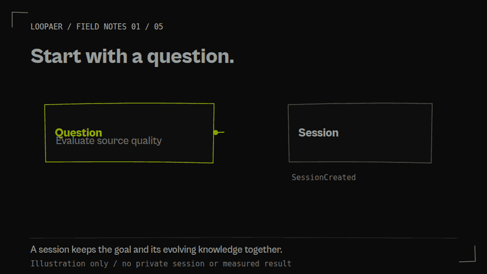
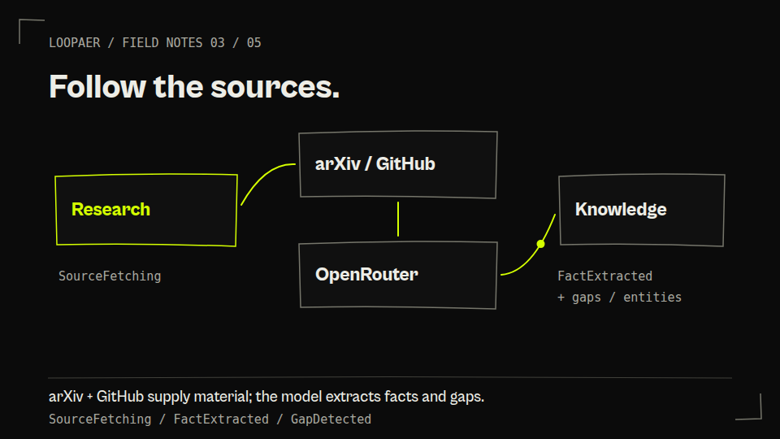
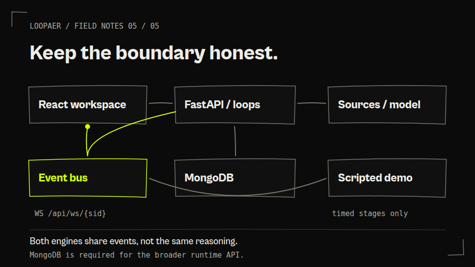

# Loopaer

Research gets hard to trust when the plan, sources and reasoning disappear into a chat transcript. Loopaer is a workbench for developers exploring agentic research: follow a question through planning, source discovery, verification and skill building, with controls to intervene.



**[Watch walkthrough](assets/readme/walkthrough.mp4)** · **[Explore interactive tour](docs/showcase/index.html)**

*A 12-second illustrated preview; the captioned walkthrough is 32 seconds. These are code-grounded diagrams, not footage of a successful research run. GitHub shows the tour's source: [run it locally](#local-walkthrough) for playback and interaction.*

<details>
<summary>Prefer a still image? Open the static field notes</summary>



[Full-size research poster](assets/readme/poster.png) · [Transcript](docs/showcase/index.html#transcript)

</details>

## What is here

Two experiences share one backend. They do **not** do the same work.

| Research runtime | Command-center demo |
| --- | --- |
| Planner, research, verification and skill-builder loops in [runtime.py](backend/runtime.py). | Six timed stages in [commandcenter.py](backend/commandcenter.py): Intake → Plan → Connect → Reason → Verify → Deliver. |
| arXiv/GitHub source discovery and OpenRouter model calls. Pause, resume, cancel and inject at cooperative checkpoints. | Scripted scenarios, mocked connector catalogs and invented outcome figures. **No enterprise integrations or measured results.** |
| Full API needs MongoDB; model work needs OpenRouter access. Verification confidence is a model judgment, not calibrated truth. | Public `/api/platform/*` endpoints can run in memory. Landing content has static fallbacks when the API is unavailable. |

## A map of the work



*REST carries requests. `/api/ws/{sid}` carries buffered lifecycle events back to the workspace; demo runs use their run ID on that same route. The event bus persists events when a database is attached.*

- [App.js](frontend/src/App.js): landing, sign-in/up, runtime, diff and snapshot routes.
- [server.py](backend/server.py) → [runtime.py](backend/runtime.py): API boundary and asynchronous loops.
- [sources.py](backend/sources.py) / [openrouter.py](backend/openrouter.py): public source retrieval and model access.
- [eventbus.py](backend/eventbus.py): fan-out, replay buffer and optional MongoDB event storage.
- [Platform contract](docs/backend-api.md): public demo endpoints, WebSocket/SSE and event envelopes.

## Start on the right branch

The implementation is on **`devs1`**. At this documentation baseline, `main` contains only README/license. This showcase PR targets `devs1`, not `main`; it does not change runtime code.

Requirements: Node 20+ (checked here with Node 24), Yarn Classic 1.22, Python 3.10+ (checked with 3.12). MongoDB is required for the broader runtime API. Use two terminals:

```bash
git switch devs1
python -m venv .venv
source .venv/bin/activate
python -m pip install -r backend/requirements.txt
cd backend
python -m uvicorn server:app --host 127.0.0.1 --port 8000
```

```bash
cd frontend
yarn install
REACT_APP_BACKEND_URL=http://127.0.0.1:8000 yarn start
```

Start without `MONGO_URL` to inspect the **command-center demo only** at `http://localhost:3000`. Its health endpoint is `http://127.0.0.1:8000/api/platform/health`. A green demo health response is not proof that auth or research endpoints work.

### Enable the research runtime

Set these in a local, ignored `backend/.env` or your shell **before starting the backend**. Never commit values.

| Variable | Purpose |
| --- | --- |
| `MONGO_URL` | Reachable MongoDB connection URI. Runtime routes still access `db` directly, even when demo startup falls back to memory. |
| `DB_NAME` | Database name; defaults to `loopaer`. |
| `FERNET_MASTER` | Stable Fernet key for encrypted secrets and JWT signing. Generate locally with `python -c "from cryptography.fernet import Fernet; print(Fernet.generate_key().decode())"`. Keep it private and stable across restarts. |
| `OPENROUTER_API_KEY` | Model access; bootstrap stores it encrypted in MongoDB. Provider availability, rate limits and costs still apply. |
| `CORS_ORIGINS` | Explicit frontend origins, e.g. `http://localhost:3000`; the existing default is `*`. |
| `FREE_MODELS_ONLY` | Optional `1` to restrict model selection to the free routing path. This does not guarantee availability. |

Frontend `REACT_APP_BACKEND_URL` is the backend origin, **without `/api`**. Sign up through `/signup`, then use the workspace. Auth is JWT-based; not every runtime API route enforces auth. This is a development prototype, not a hardened public deployment.

Auth uses passlib's bcrypt scheme. The current requirements do not explicitly install `bcrypt`; platforms without a system `crypt` bcrypt backend need a compatible bcrypt package too. Password hashing works in the checked Linux/Python 3.12 environment, but that does not verify the full signup flow.

### Build and checks

```bash
cd frontend
CI=false yarn build
CI=true yarn test --watchAll=false --passWithNoTests
```

```bash
# From the repository root, with the Python environment active:
python -m pip install pytest pytest-asyncio
python -m pytest -q tests/test_showcase.py
python -m pytest -q tests/test_platform_api.py
```

The platform tests deliberately unset `MONGO_URL` and use FastAPI in-process. Other backend tests are live-service integration tests: they need a running backend, MongoDB, and in some cases model access (`requests` is also needed). They contain historical expectations; do not interpret them as an offline test suite. See [exact checks and existing failures](docs/showcase-evidence.txt).

## Local walkthrough

No application build, account, database or key is needed. Install only the isolated docs tools (Node 20+):

```bash
cd docs/showcase
npm ci
npm run serve
# Open http://127.0.0.1:8765/docs/showcase/
```

The separate page provides native, user-controlled video playback, captions/transcript, chapter scrubbing, keyboard/touch node selection and a six-step explanatory pipeline tour. The loopback server uses a curated temporary snapshot with HTTP byte ranges, not the whole checkout: env files, credentials and repository metadata are excluded. Restart it after edits. Reduced-motion defaults to static diagrams. Without JavaScript, the video, transcript and architecture notes remain useful. No hosted tour is claimed.

<details>
<summary>Regenerate the media / provenance</summary>

Install system **Chromium and FFmpeg** with H.264 support, then:

```bash
cd docs/showcase
npm ci
CHROMIUM_PATH=/usr/bin/chromium npm run render
```

The isolated tools use Playwright (Apache-2.0) and http-server (MIT); neither is a production dependency. Sources are [scenes.js](docs/showcase/scenes.js), [render.mjs](docs/showcase/render.mjs) and [captions.vtt](docs/showcase/captions.vtt). Cabinet Grotesk is reused from the existing landing font files; no third-party visuals or private captures are used. The PNG posters preserve that typography; the standalone SVG uses an Arial fallback. The tour offers [WebM](assets/readme/walkthrough.webm) and MP4 for browser codec compatibility.

Budgets: **≤2 MB per GIF, ≤10 MB for the walkthrough**, using decimal bytes. Rendered assets, tool versions, measured sizes, limitations and reproduction commands are recorded in [showcase-evidence.txt](docs/showcase-evidence.txt). [Contact sheet](assets/readme/contact-sheet.png).

</details>

## Limits worth knowing

The demo's in-memory state is process-local and resets on restart. The event bus is not a durable job queue. Source retrieval can fail; model output can be malformed; fallback plans/skills do not establish verified results. The walkthrough illustrates code paths and leaves these failure modes visible rather than inventing a finished session.

Historical [backend](docs/backend-smoke-evidence.md) and [frontend](docs/frontend-smoke-evidence.md) smoke notes describe checks from August 2026, not new performance claims. [Product brief](docs/product-brief.md) and [design guidelines](design_guidelines.json) explain the intended direction, not proof of delivered enterprise capabilities.

## License and authorship

[MIT license](LICENSE). Existing license and contributor attribution are preserved. This documentation and its original diagrams were prepared with GitHub Copilot; they do not imply owner-only authorship.
